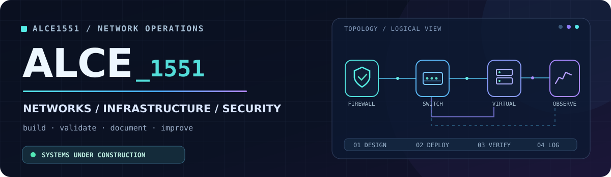

<div align="center">

<a href="https://github.com/Alce1551/EICL-HOMELAB">
  
</a>

<a href="https://github.com/Alce1551/EICL-HOMELAB">
  
</a>

<br>


<br><br>

[**🌐 Portafolio**](https://github.com/Alce1551/EICL-HOMELAB) &nbsp;·&nbsp;
[**📐 Arquitectura**](https://github.com/Alce1551/EICL-HOMELAB/blob/main/docs/architecture.md) &nbsp;·&nbsp;
[**🧪 Laboratorios**](https://github.com/Alce1551/EICL-HOMELAB/tree/main/labs)

</div>

---

### `WHOAMI`

```yaml
Nombre:       Alce
Perfil:       Network & Infrastructure  ──►  Defensive Security
Base:         Ciudad de México
Estudios:     Maestría en Gestión de Tecnologías de Información (en curso)
Laboratorio:  EICL · FortiGate · Huawei · Omada · Proxmox VE · VMware ESXi
Principio:    "Si no está documentado, no está terminado."
```

Monto redes empresariales en mi propio laboratorio, **las rompo a propósito** y documento cómo volver a levantarlas.

Me interesa lo que pasa entre el cable y el firewall: cómo se segmenta una red, por qué un paquete no llega y cómo se deja todo listo para que otra persona lo entienda sin preguntarme.

Mi ruta va de **Network Operations (NOC)** e infraestructura TI hacia **Blue Team / SOC**, con cada paso respaldado por evidencia en este perfil.

---

### `Tecnologías usadas`

<div align="center">

#### SISTEMAS OPERATIVOS


<!-- Descomenta las distros que uses:


-->

#### NETWORKING & SECURITY


<!-- Descomenta lo que uses:


-->

#### VIRTUALIZACIÓN & INFRAESTRUCTURA


<!--  -->

#### AUTOMATIZACIÓN & DOCUMENTACIÓN


<!--  -->

#### CIBERSEGURIDAD & PRÁCTICA

<!-- Descomenta las plataformas donde practiques:


-->


</div>

### `Principales Intereses`

<table>
  <tr>
    <td><b>🌐 Networking</b></td>
    <td>TCP/IP · Switching & Routing · VLAN 802.1Q · STP · Trunking · ACL · Troubleshooting</td>
  </tr>
  <tr>
    <td><b>🛡️ Security</b></td>
    <td>FortiOS · Políticas de firewall · Segmentación · Mínimo privilegio · Acceso administrativo seguro</td>
  </tr>
  <tr>
    <td><b>🖥️ Systems</b></td>
    <td>Linux · Proxmox VE · VMware ESXi · Redes virtualizadas</td>
  </tr>
  <tr>
    <td><b>🧩 Workflow</b></td>
    <td>Git · Bash · LaTeX · Control de cambios · Documentación técnica</td>
  </tr>
</table>

---

### `Proyecto Insignia`

<div align="center">

## 🛰️ [EICL — Enterprise Infrastructure & Cybersecurity Lab](https://github.com/Alce1551/EICL-HOMELAB)

**Una red empresarial completa, construida en casa y documentada como si fuera de producción.**

</div>

Diseño, implementación, pruebas y evidencias saneadas de una infraestructura real: firewall perimetral, switching segmentado por VLAN y virtualización. Cada decisión queda registrada con su porqué.

| Estado | Alcance |
|:--|:--|
| ✅ **Operativo** | Red base · VLANs y segmentación · Políticas de firewall · Switching · Pruebas de conectividad |
| 🔧 **En construcción** | Consolidación de virtualización con Proxmox VE y VMware ESXi |
| 🧭 **Siguiente** | Servicios de infraestructura · Monitoreo · Centralización de logs · Prácticas Blue Team |

<div align="center">

[**Diseño de red**](https://github.com/Alce1551/EICL-HOMELAB/blob/main/docs/architecture.md) &nbsp;·&nbsp;
[**Plan de VLANs**](https://github.com/Alce1551/EICL-HOMELAB/blob/main/docs/vlan-plan.md) &nbsp;·&nbsp;
[**Implementación**](https://github.com/Alce1551/EICL-HOMELAB/blob/main/docs/implementation.md) &nbsp;·&nbsp;
[**Repositorio completo →**](https://github.com/Alce1551/EICL-HOMELAB)

</div>

---

### `Metodología de trabajo`

```text
  [ AS-IS ] ──► [ DESIGN ] ──► [ DEPLOY ] ──► [ TEST ] ──► [ DOCUMENT ]
                    ▲                                          │
                    └──────────────── [ IMPROVE ] ◄────────────┘
```

Que algo funcione es el punto de partida. Lo que me importa es entender **por qué funciona**, **cómo diagnosticarlo cuando falla** y **cómo repetirlo** a partir de la documentación.

---

### `Estadísticas de trabajo`

<div align="center">


<br>


<br>


<sub>Estadísticas generadas por servicios externos; pueden no cargar ocasionalmente. Los lenguajes reflejan el contenido de los repos públicos, no el nivel técnico.</sub>

</div>

---

### `Roadmap Actual`

- [x] Red base segmentada con VLANs y firewall perimetral
- [x] Documentación versionada con evidencias saneadas
- [ ] Consolidar la capa de virtualización (Proxmox VE + ESXi)
- [ ] Servicios Linux de infraestructura dentro del laboratorio
- [ ] Monitoreo y registro centralizado de eventos
- [ ] Primeros ejercicios de detección y análisis defensivo

---

<div align="center">

**ALCE1551** · Network Operations · Infrastructure · Defensive Security

<sub>Proyectos personales con documentación pública saneada. Progreso verificable, no promesas infladas.</sub>

<!-- Si quieres agregar contacto, descomenta y pon tu enlace:
<br><br>
<a href="https://www.linkedin.com/in/TU-USUARIO"></a>
-->

</div>
